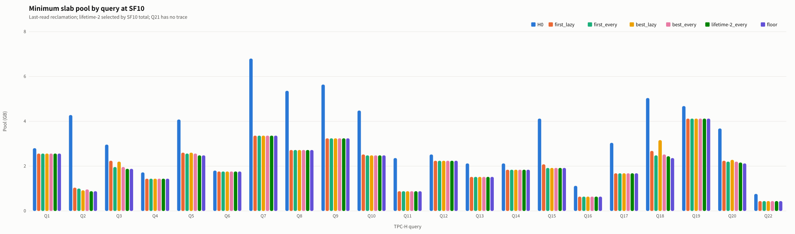
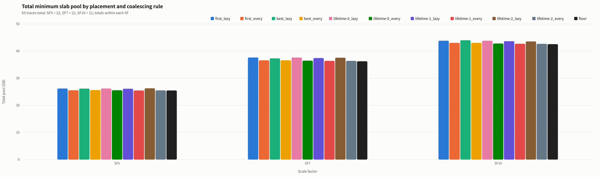

# 2026-10-20 S4: Offline Replay of Slab Placement and Coalescing Timing

## Objective
Use raw baseline traces to compare minimum pool capacity under different placement rules and coalescing timings, ideally reclaiming all blocks after the operator that last reads an allocation finishes. Analyze only the slab, excluding PyTorch-side memory, without modifying the executor.

## Configuration and Execution
- Inputs are `trace/queries.csv`, `ops.csv`, `allocs.csv`, and `reads.csv` from the adjacent baseline experiment.
- 65 traces total: 22 each at SF5 and SF7, and 21 at SF10; SF10 Q21 has no trace and is neither zero-filled nor replaced with SF7.
- Block size: $B = 40{,}000{,}000$ bytes; decimal units: $1\,\mathrm{GB} = 10^9$ bytes
- Run `python3 -B 2026-10-20-s4-placement-replay/analyze_s4.py` from `experiments/profiling/`.
- Data analysis uses only the standard library, without torch / GPU; SVG generation uses `svgplot.py`, and PNG generation uses its `render_png` (local Chrome).
  PNGs for this run were generated with the existing local librsvg/Cairo installation through a temporary execution wrapper; no packages were installed and this dependency was not added to the script.

## Method
Reuse `load_traces`, `allocation_lifetimes`, and `Pool` from `analyze_baseline.py`.
Preserve the original operator row order; within each operator, sort allocations by original starting block, block count, and requested bytes. Consider only `in_slab` reads, using block-range overlap to determine lifetimes.
Complete all allocations for an operator before freeing expired allocations in original allocation order; unread allocations are freed after their allocating operator finishes. Lifetimes always come from original addresses; replayed addresses are not used to rematch reads.

| Placement rule | Definition |
|---|---|
| `first` | Select the first sufficiently large segment in free-list order and allocate from its low end; the list is not necessarily address-sorted |
| `best` | Select the shortest sufficiently large segment, breaking ties by lowest address, and allocate from its low end |
| `lifetime-t` | When $\operatorname{last\_use}(a)-i_a\le t$, scan addresses from high to low for the first sufficiently large segment and allocate from its high end; otherwise use `first` and allocate from the low end; $t\in\{0,1,2\}$ |
| `lazy` | Append each freed segment to the free list; on the sixth free, sort and coalesce adjacent segments, then reset the counter |
| `every` | Sort and coalesce adjacent segments on every free |

First confirm success at capacity $H_0$, then binary-search between the lower bound and $H_0$. Placement may change with capacity, so success cannot be assumed monotonic; additionally check every block capacity from the lower bound to the binary-search candidate to find the global minimum. Finally, replay at that capacity and one block less to confirm success and failure, respectively.
If replay still fails at $H_0$, leave capacity and time blank in the CSV; blanks are not counted as zero in summaries. Totals display NA, medians and maximum times include only successful cases, and incomplete series are omitted from figures.

## Metric Definitions
| Metric | Definition |
|---|---|
| Allocating operator index | $i_a$, zero-based in original operator order |
| `last_use` | $\operatorname{last\_use}(a)=\max\{j: \text{slab reads of operator }j\text{ overlap the block range of allocation }a\}$; use $i_a$ if no read overlaps |
| `highwater_bytes` | $H_0=B\sum_a n_a$, where $n_a$ is the allocation's block count; checked against baseline |
| `floor_blocks` | $\max_j\sum_{a:i_a\le j\le\operatorname{last\_use}(a)}n_a$, the maximum occupied block count after allocations and before frees within an operator |
| `floor_bytes` | $B\cdot\mathrm{floor\_blocks}$; includes internal block fragmentation and differs from the peak of actual requested bytes |
| `min_pool_blocks` | $\min\{C\in\mathbb{Z}: \text{replay succeeds with a capacity of }C\text{ blocks}\}$ |
| `<placement>_<coalescing>_pool_bytes` | $B\cdot\mathrm{min\_pool\_blocks}$ |
| `<placement>_<coalescing>_merge_us` | Sum of `time.perf_counter` durations for all sorting and coalescing during the confirmation replay at minimum capacity, in $\mu\mathrm{s}$; excludes search replays |

Coalescing time includes frees at query end but excludes appending freed segments, placement scans, and lifetime computation. It is a microsecond-scale estimate from a single local Python run, subject to timer and scheduling noise, and must not be interpreted as a GPU query speedup.

## Files and Figures
| File | Contents |
|---|---|
| `analyze_s4.py` | Replay, global minimum capacity validation, CSV output, plotting, and generation of these notes |
| `s4_replay.csv` | One row per SF / query; four reference columns and ten sets of capacity and coalescing time |
| `figures/1_pool_need_sf10.svg`, `.png` | Seven SF10 series; the lifetime threshold is selected by the SF10 total for every, breaking ties in favor of the smaller threshold |
| `figures/2_summary.svg`, `.png` | Grouped by SF, with totals for ten combinations and floor; totals do not represent capacity for running all queries concurrently |





## Main Results
- SF5: $H_0$ total 50.04 GB; `first_lazy` 26.20 GB; minimum total 25.48 GB (`lifetime-1_every`); floor total 25.48 GB.
- SF7: $H_0$ total 65.60 GB; `first_lazy` 37.64 GB; minimum total 36.40 GB (`lifetime-1_every`, `lifetime-2_every`); floor total 36.24 GB.
- SF10: $H_0$ total 71.48 GB; `first_lazy` 43.84 GB; minimum total 42.68 GB (`lifetime-2_every`); floor total 42.56 GB.
- The SF10 figure uses `lifetime-2_every`.
- Global checks corrected 0 binary-search candidates; all 650 successful cases were validated at the minimum capacity and one block less.
- All combinations are at least floor; `first_lazy` does not exceed baseline's `highwater_free_bytes`.

## Summary
Totals and medians are in GB; maximum coalescing time is the largest single-query value within that SF.

```text
SF  Rule                 Sum_GB  Median_GB  Max_merge_us  Success
5   H0                    50.040      2.140             -  22/22
5   floor                 25.480      1.120             -  22/22
5   first_lazy            26.200      1.180        27.064  22/22
5   first_every           25.560      1.140        98.486  22/22
5   best_lazy             26.160      1.160        28.376  22/22
5   best_every            25.640      1.140        66.027  22/22
5   lifetime-0_lazy       26.200      1.180        22.324  22/22
5   lifetime-0_every      25.560      1.140        54.381  22/22
5   lifetime-1_lazy       26.120      1.180        21.599  22/22
5   lifetime-1_every      25.480      1.120        68.760  22/22
5   lifetime-2_lazy       26.280      1.220        16.881  22/22
5   lifetime-2_every      25.520      1.140        53.893  22/22
7   H0                    65.600      2.760             -  22/22
7   floor                 36.240      1.620             -  22/22
7   first_lazy            37.640      1.740        20.733  22/22
7   first_every           36.600      1.660       198.892  22/22
7   best_lazy             37.320      1.720        28.322  22/22
7   best_every            36.600      1.660        86.027  22/22
7   lifetime-0_lazy       37.640      1.740        19.946  22/22
7   lifetime-0_every      36.480      1.640       101.253  22/22
7   lifetime-1_lazy       37.440      1.720        26.137  22/22
7   lifetime-1_every      36.400      1.640        74.059  22/22
7   lifetime-2_lazy       37.560      1.800        18.656  22/22
7   lifetime-2_every      36.400      1.640        63.779  22/22
10  H0                    71.480      3.040             -  21/21
10  floor                 42.560      1.920             -  21/21
10  first_lazy            43.840      2.240        22.613  21/21
10  first_every           43.040      1.960        77.755  21/21
10  best_lazy             44.000      2.200        48.396  21/21
10  best_every            43.040      1.960        66.622  21/21
10  lifetime-0_lazy       43.840      2.240        23.123  21/21
10  lifetime-0_every      42.800      1.920        72.545  21/21
10  lifetime-1_lazy       43.640      2.200        23.520  21/21
10  lifetime-1_every      42.720      1.920        61.698  21/21
10  lifetime-2_lazy       43.560      2.200        18.848  21/21
10  lifetime-2_every      42.680      1.920        70.232  21/21
```
