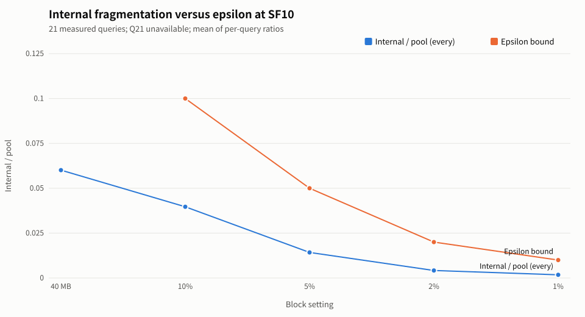
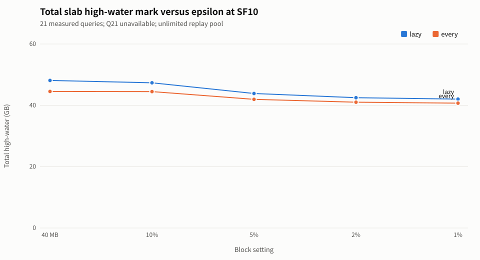

# 2026-10-21 S2: Offline Replay of Method A's ε and Slab Fragmentation

## Objective
Using measured S3 reclamation timings, compare fixed 40 MB blocks with block sizes planned by method A, quantify changes in internal fragmentation and slab high-water mark, and check theoretical bounds.
Do not simulate PyTorch-side memory or infer GPU runtime from this analysis.

## Configuration and Execution
- Run `python3 -B 2026-10-21-s2-eps/analyze_eps.py` locally from `experiments/profiling/`; analysis uses only the Python standard library, without torch.
- On the server, run `python3 -B 2026-10-21-s2-eps/plan_n_live.py` from the same directory in the project environment
  to rebuild `plan_n_live.csv` from the 22 query pickles; this script depends on the server's torch and plan-deserialization environment and is not run locally.
- Reuse S3's `load_traces()` for input: `trace-rerun/` fully replaces the corresponding `trace/` records by SF / query; analyze successful queries only. SF10 Q21 has no data and is not zero-filled.
- Decimal units: $1\,\mathrm{MB}=10^6$ bytes, $1\,\mathrm{GB}=10^9$ bytes

## Method
Preserve CSV row order for operators, allocations, and frees. Original starting blocks are used only to match the current allocation when freeing; independent allocation IDs are used after matching,
so block-address reuse does not confuse lifetimes. Allocations absent from free records remain until query completion.
For each operator, allocate first, record the state before freeing, then free in the original order.
Use the first operator end at which the occupied-extent endpoint reaches its maximum, matching S3's snapshot definition; only allocations occur within an operator, so this definition cannot miss a higher address peak.

Reuse baseline's `Pool`: first-fit selects the first available segment in free-list order and allocates from its low end; frees append to the end of the list.
`lazy` sorts and coalesces on every sixth free; `every` coalesces on every free. Replay pool capacity is the sum of all rounded-up allocation capacities, ensuring capacity is not a constraint;
the measured pool capacity does not limit replay. The tail segment of a finite pool may change the first-fit path, so fixed-block replay is also compared row by row with measurements.

Use `n_live_free_dead` as the planned column count, taking the maximum of `max_live_columns(p.ops_idx, p.ops_dict, True)` over all plans;
also save `n_live_no_free` without S3 to reproduce the original table. Pool capacity is the query's `gpu_pool_gb` after merging the records.

$$
b_{\mathrm{MB}}=\max\left(1,\left\lfloor\frac{\varepsilon P}{N\,10^6}\right\rfloor\right),\qquad b=10^6 b_{\mathrm{MB}}
$$

$N$ is the maximum of "columns still live on entry to an operator + that operator's output columns" (each output receives a new allocation while inputs remain occupied during operator execution).
The number of simultaneously occupied allocations is at most $N$, and rounding wastes at most one block per allocation, so $I\le Nb$; this experiment checks every row. The 1 MB minimum can also violate $Nb\le\varepsilon P$,
so the script checks this planning inequality separately; fixed 40 MB blocks have no corresponding ε bound.

## Derived Column Definitions
Let $A$ be the set of allocations in the first maximum-high-water snapshot, $s_a$ the requested bytes, $p_a$ the replay starting block, and $c_a=\max(1,\lceil s_a/b\rceil)$ the occupied block count

| Column | Definition |
|---|---|
| `sf`, `qid`, `setting`, `merge` | Scale, query, block-size setting, and coalescing timing; `setting` is `40MB` or a decimal string for ε |
| `block_mb`, `n_live`, `pool_bytes` | $b/10^6$, $N$, $P$ |
| `highwater_bytes` | $H=\max_t\max_{a\in A_t}(p_a+c_a)b$ |
| `internal_bytes` | $I=\sum_{a\in A}(c_ab-s_a)$ |
| `internal_frac` | $I/H$, using the high-water mark including holes as the denominator |
| `bound_bytes` | $Nb$ |
| `bound_holds` | $I\le Nb$, distinct from the planning condition $Nb\le\varepsilon P$ |

## Figures
English SVGs are generated by `svgplot.py`, with `render_png` producing PNGs of the same name.



Figure 1 uses the arithmetic mean of per-query $I/P$ at SF10 and plots only `every`; the reference line is $y=\varepsilon$, with no reference point for fixed 40 MB blocks



Figure 2 sums $H$ over all available SF10 queries, plotting `lazy` and `every` separately; totals do not represent pool capacity for concurrent query execution

## Main Results
- Data coverage: SF5: 22 queries, SF7: 22 queries, SF10: 21 queries; 650 output rows.
- SF10 / `40MB` / `every`: total high-water mark 44.520 GB, mean internal fragmentation / pool capacity 6.007%.
- SF10 / `0.10` / `every`: total high-water mark 44.480 GB, mean internal fragmentation / pool capacity 3.968%.
- SF10 / `0.05` / `every`: total high-water mark 41.947 GB, mean internal fragmentation / pool capacity 1.424%.
- SF10 / `0.02` / `every`: total high-water mark 41.020 GB, mean internal fragmentation / pool capacity 0.417%.
- SF10 / `0.01` / `every`: total high-water mark 40.709 GB, mean internal fragmentation / pool capacity 0.175%.
- Internal fragmentation bound violations: 0 rows.
- Planning bound violations: 1 SF / query / ε combination (counting the two coalescing timings only once).
- SF7 Q16 ε=0.01: 16000000 > 1.44e+07 bytes
- Row-by-row comparison of 40 MB / lazy with measured S3 high-water marks: 0 mismatches. All 65 rows match.

## Summary
Mean fragmentation is reported with both the high-water mark and measured pool capacity as denominators; totals are in GB.

```text
SF  Setting Merge  Sum_H_GB  Mean_I/H_%  Mean_I/P_%  Bound_fail
5   40MB    lazy     29.800      25.777      10.489           0
5   40MB    every    26.440      25.175       8.121           0
5   0.10    lazy     27.120      17.037       5.328           0
5   0.10    every    25.039      17.610       4.334           0
5   0.05    lazy     24.360       7.860       2.005           0
5   0.05    every    22.942       8.705       1.759           0
5   0.02    lazy     23.152       2.938       0.602           0
5   0.02    every    21.978       3.173       0.473           0
5   0.01    lazy     22.726       1.000       0.220           0
5   0.01    every    21.707       0.975       0.156           0
7   40MB    lazy     41.760      23.346      13.126           0
7   40MB    every    37.720      25.658      11.984           0
7   0.10    lazy     35.330      11.864       4.763           0
7   0.10    every    32.874      11.635       3.715           0
7   0.05    lazy     33.206       6.397       2.156           0
7   0.05    every    31.483       6.255       1.628           0
7   0.02    lazy     32.063       2.305       0.706           0
7   0.02    every    30.644       2.376       0.557           0
7   0.01    lazy     31.618       0.955       0.267           0
7   0.01    every    30.359       0.977       0.200           0
10  40MB    lazy     48.120      14.999       7.512           0
10  40MB    every    44.520      15.150       6.007           0
10  0.10    lazy     47.353      11.767       5.015           0
10  0.10    every    44.480      11.514       3.968           0
10  0.05    lazy     43.866       5.346       2.002           0
10  0.05    every    41.947       4.836       1.424           0
10  0.02    lazy     42.482       1.699       0.607           0
10  0.02    every    41.020       1.524       0.417           0
10  0.01    lazy     42.027       0.725       0.247           0
10  0.01    every    40.709       0.660       0.175           0
```
